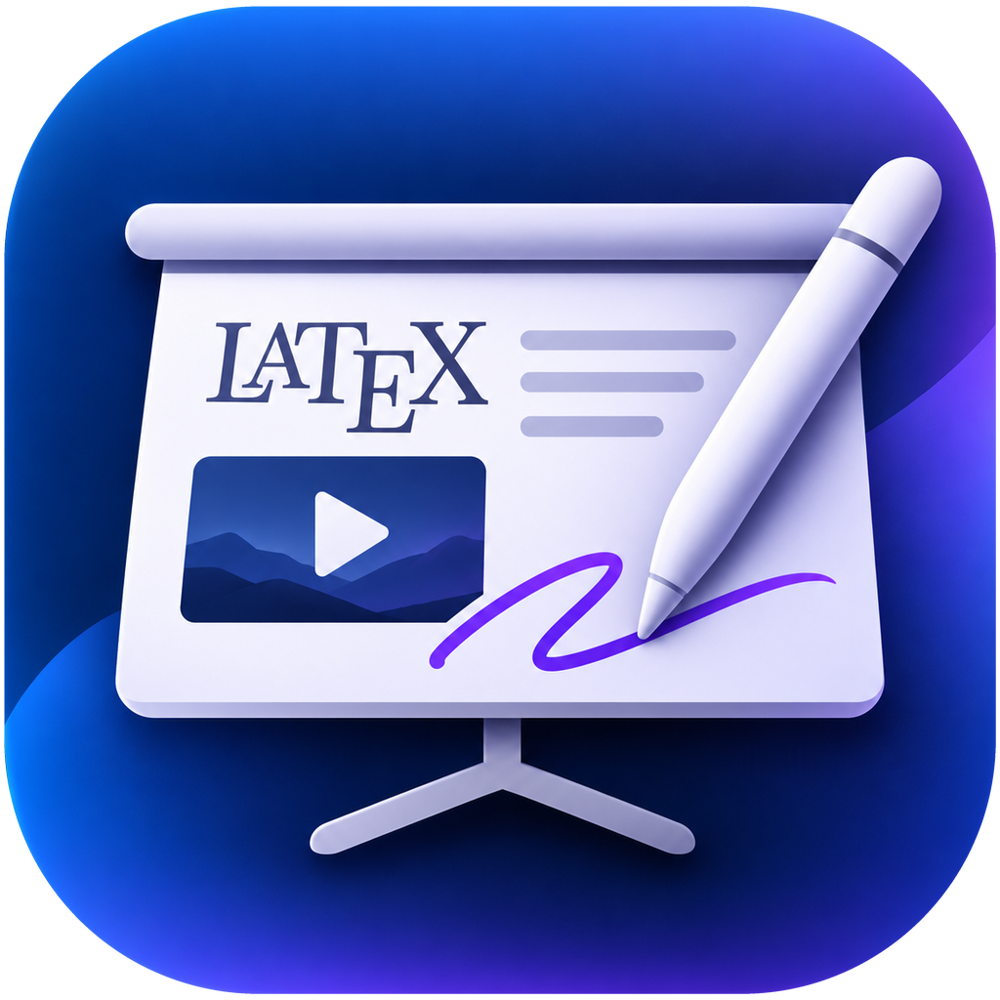
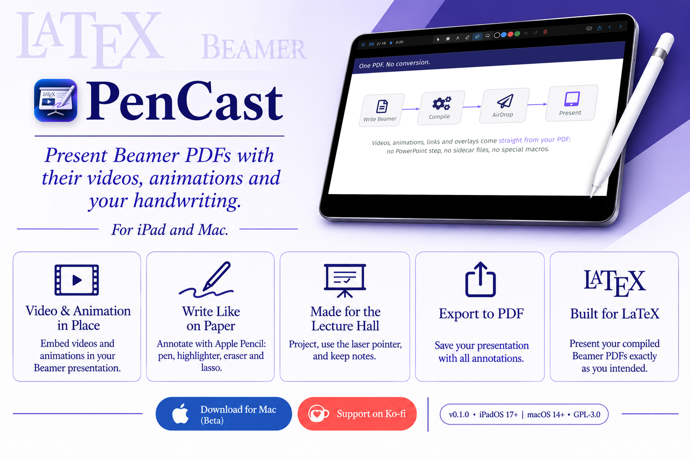
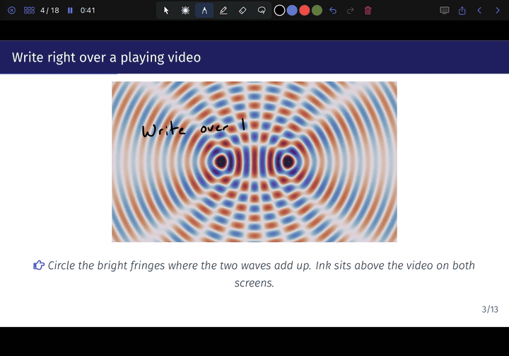

#  PenCast

  

  
  
  

  
  
  

  
   
  <a href="docs/media/pencast_demo.mp4"><b>▶ Watch the full demo</b></a> (3 min)

---

PenCast opens the PDF you compiled from LaTeX and presents it exactly as it is. Videos and animations play
right on the slide, you write over everything with Apple Pencil, and a projector shows the clean slide while
your iPad keeps the controls.

## Features

- **Video and animation in place.** Embedded videos (media9, `\movie`, standard PDF video) and `animate`
  sequences play on the slide with their own autoplay and loop settings.
- **Write like on paper.** A pressure-sensitive fountain pen, ball pen, highlighter, lasso and eraser, with
  notes that stay on a slide while `\pause` reveals the rest.
- **Laser pointer.** A glowing trail that fades when you lift, or a simple dot.
- **Zoom in to write neatly.** Pinch and pan smoothly; the projector shows the whole slide or follows you.
- **Made for the lecture hall.** HDMI or AirPlay projector output, black/white/freeze, speaker notes and a talk
  timer.
- **Take your notes with you.** Export a handout with one page per slide and your ink, or every page.
- **Built for writing slides too.** On the Mac, an open deck reloads itself each time LaTeX recompiles it.

## Download

**Mac (beta):** [download PenCast for Mac](https://github.com/e1ind/pencast/releases/latest/download/PenCast-mac.dmg),
open the disk image and drag PenCast to Applications. Requires macOS 14 or later, Apple silicon or Intel.

> [!NOTE]
> The beta isn't notarized by Apple yet, so macOS blocks it the first time. Open it once, then go to
> **System Settings → Privacy & Security** and click **Open Anyway**. You only need to do this once.

**iPad:** coming to the App Store. Until then you can [build it from source](docs/BUILDING.md).

**Linux (beta):** the reading view, presenting, projector, laser, pen, highlighter and eraser, with a mouse,
touch or a pen tablet (videos, animations, zoom and export come next). Download the package for your system:

| System | Download | Install |
| --- | --- | --- |
| Rocky, RHEL, AlmaLinux 9 | [pencast-el9.x86_64.rpm](https://github.com/e1ind/pencast/releases/latest/download/pencast-el9.x86_64.rpm) | `sudo dnf install epel-release && sudo dnf install ./pencast-el9.x86_64.rpm` |
| Rocky, RHEL, AlmaLinux 10 | [pencast-el10.x86_64.rpm](https://github.com/e1ind/pencast/releases/latest/download/pencast-el10.x86_64.rpm) | `sudo dnf install epel-release && sudo dnf install ./pencast-el10.x86_64.rpm` |
| Fedora | [pencast-fedora.x86_64.rpm](https://github.com/e1ind/pencast/releases/latest/download/pencast-fedora.x86_64.rpm) | `sudo dnf install ./pencast-fedora.x86_64.rpm` |
| Ubuntu 24.04, Linux Mint 22 | [pencast-ubuntu-24.04_amd64.deb](https://github.com/e1ind/pencast/releases/latest/download/pencast-ubuntu-24.04_amd64.deb) | `sudo apt install ./pencast-ubuntu-24.04_amd64.deb` |
| Ubuntu 26.04 | [pencast-ubuntu-26.04_amd64.deb](https://github.com/e1ind/pencast/releases/latest/download/pencast-ubuntu-26.04_amd64.deb) | `sudo apt install ./pencast-ubuntu-26.04_amd64.deb` |
| Debian 13 | [pencast-debian-13_amd64.deb](https://github.com/e1ind/pencast/releases/latest/download/pencast-debian-13_amd64.deb) | `sudo apt install ./pencast-debian-13_amd64.deb` |
| Any other (openSUSE, Arch, …) | [PenCast-x86_64.AppImage](https://github.com/e1ind/pencast/releases/latest/download/PenCast-x86_64.AppImage) | `chmod +x PenCast-x86_64.AppImage`, then run it |

The packages use your system's Qt; Rocky and RHEL get its PDF module from EPEL (on RHEL, enable the
CodeReady Builder repository too). Then point your LaTeX editor's PDF viewer at `pencast %f`. You can also
[build it from source](docs/BUILDING.md#linux).

## Help bring PenCast to the App Store

PenCast is free and open source. Publishing it on the App Store, and notarizing the Mac app so it opens without
warnings, requires Apple's Developer Program at **$99 a year**. If PenCast is useful to you, a contribution
toward that goal makes the release possible.

  

## Roadmap

- **App Store release** for iPad and Mac.
- **Linux:** videos and animations, zoom and export; Flatpak. **Windows** from the same Qt code.
- **PowerPoint and Keynote:** present their PDF exports with the original videos playing in place.
- **More sources:** any app that exports PDF (Google Slides, LibreOffice Impress) already works without video.

## Documentation

- [User guide](docs/GUIDE.md): presenting, writing tools, zoom, projectors, exporting, preparing decks
- [Building from source](docs/BUILDING.md): iPad and Mac builds, releases, tests
- [Technical notes](docs/TECHNICAL.md): how PDF media is found, ink, zoom, performance
- [Changelog](CHANGELOG.md)

## License

PenCast is free software under the [GNU General Public License v3.0](LICENSE).
